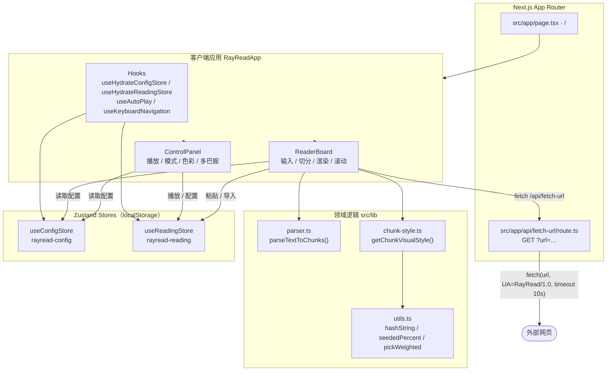
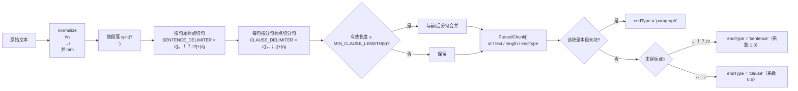
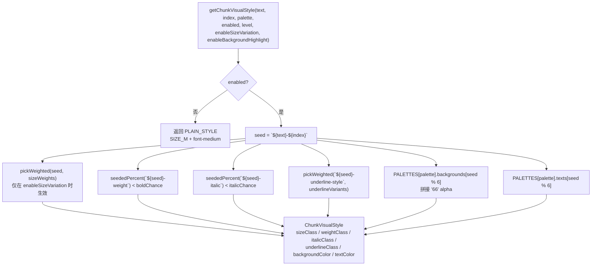
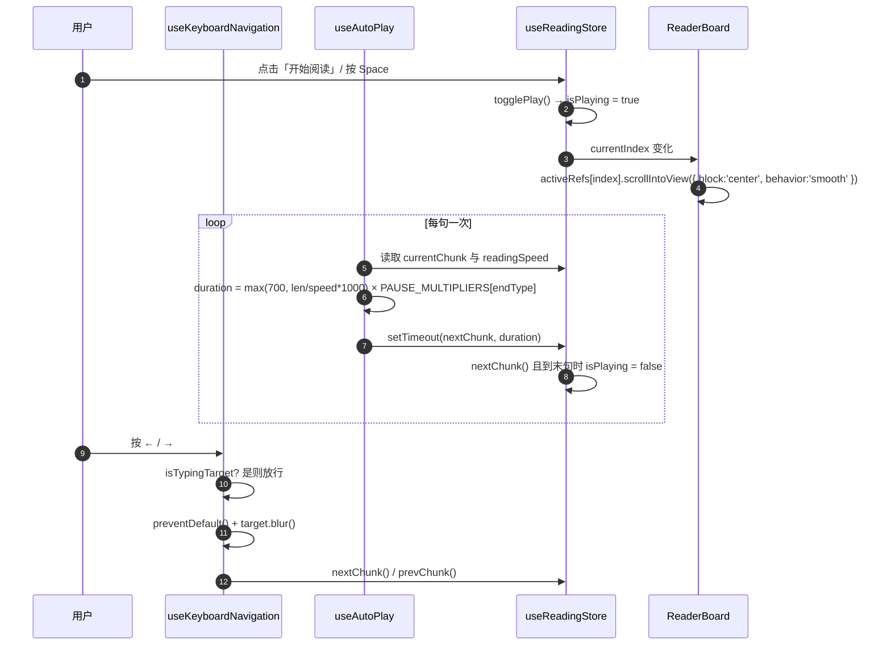
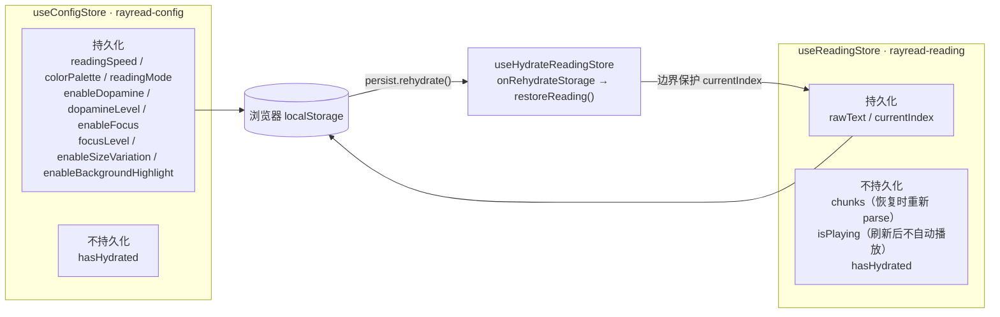
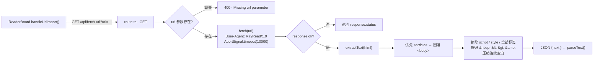

<div align="center">

> [English](./README_en.md) | **简体中文**


# RayRead — 让视线跟着句子温柔巡航的专注阅读器

**把一屏长长的文字，切成一句一句轻轻点亮的小木牌。**


</div>

---

## 它解决什么问题

长文阅读时，视线总想「抢跑」——你要同时处理一整屏文字，眼睛追着段落跑，注意力却被下一段、再下一段不断牵扯走。

**RayRead 把长文本按中英文标点切成句子与短分句，一次只点亮你正在读的那一句，其余内容自动退到背景里。** 配合自动巡航与键盘翻句，你不再需要「追赶」整篇文章，只要跟着眼前这一句，慢慢往前走。

它是一套**纯前端、无账号、无数据库**的本地阅读器：

> 阅读正文**不落盘**；只有阅读偏好与阅读进度保存在浏览器 `localStorage`，不上传服务器。URL 转正文只经由一个服务端代理路由，用于绕过浏览器跨域限制。

---

## ✨ 功能

- 🔤 **智能切句**：按 `。！？.!?` 切句、按 `，、；,;` 切分句，保留原标点；过短的碎分句（有效长度 ≤ 5）自动与相邻分句合并。
- 💡 **逐句高亮 + 沉浸聚焦**：当前句叠加暖黄高亮 `bg-[#fff7d6]` 并轻微放大，非当前句降到 30% 透明度；`全页` 聚焦档还会叠加一层暗色遮罩形成聚光灯效果。
- ⏱️ **自动巡航**：按句长与阅读速度计算停留时长，可暂停/继续；逗号结尾停顿更短、段落结尾停顿更长。
- ⌨️ **键盘导航**：`Space` / `→` 下一句，`←` 上一句；自动跳过文本框、输入框与可编辑区域，并主动释放控件焦点。
- 🖥️ **两种阅读模式**：`歌词模式`一句一行的块级卡片（追焦跟读），`文稿模式`保留连续段落排版的 inline 流式高亮。
- 🎨 **多巴胺视觉辅助**：`温和 / 多巴胺 / 跳跃` 三档强度，随机生成字号起伏、加粗、斜体、下划线（实线/波浪线/双线）、文字色与半透明背景色。
- 🌈 **四套色彩池**：`Macaron`、`Mid-Century`、`Morandi`、`Ink Wash`，统一「浅背景 + 深文字」，长时间阅读更不易疲劳。
- 📥 **多方式导入**：直接粘贴、拖拽 / 选择 `.txt` 文件、或粘贴网页 URL 由服务端代理提取正文。
- 📊 **阅读统计**：实时显示阅读时长、已读句数、预估剩余时间。
- 🔄 **进度续读**：刷新页面后自动恢复上次的文本与阅读位置（`chunks` 在恢复时即时重算）。
- 🔒 **隐私友好**：正文不持久化，偏好仅存本机 `localStorage`。

---

## 🚀 快速开始

### 方式一：面向 AI Agent（一键安装，推荐）

把下面这段提示词直接发给你的本地 AI Agent（Claude Code / Codex / OpenCode …），它会自动完成安装与启动：

````markdown
请帮我安装并启动 RayRead（GitHub: https://github.com/RayMorTwinkle/RayRead）。
背景：RayRead 是一个 Next.js 15 的纯前端专注阅读器，把长文本按句切分后逐句高亮、自动巡航。
环境要求：Node.js 18.18+，包管理器使用 npm（仓库自带 package-lock.json）。

步骤：
1. 克隆：git clone https://github.com/RayMorTwinkle/RayRead.git && cd RayRead
2. 安装依赖：npm install
3. 启动开发服务器：npm run dev
4. 打开浏览器访问 http://localhost:3000 ，应看到 RayRead 阅读界面
5. 可选验证：npm run lint 与 npm run typecheck 均应通过
6. 向用户确认启动成功，并简述「粘贴文本 → 开始阅读 → 键盘翻句」的用法
````

### 方式二：面向人类用户

```bash
# 1. 克隆仓库
git clone https://github.com/RayMorTwinkle/RayRead.git
cd RayRead

# 2. 安装依赖
npm install

# 3. 启动开发服务器
npm run dev
```

打开浏览器访问 <http://localhost:3000>。

> **环境要求**：Node.js **18.18+**（Next.js 15 要求）、npm。
> 仓库自带 `package-lock.json`，默认使用 **npm**；若你坚持用 pnpm/yarn，请先删除 `package-lock.json` 与 `node_modules` 再重新安装，避免 lock 文件冲突。

### 常用命令

| 命令 | 作用 |
|---|---|
| `npm run dev` | 启动 Next.js 开发服务器（默认 `localhost:3000`） |
| `npm run build` | 构建生产版本 |
| `npm run start` | 运行生产构建后的应用 |
| `npm run lint` | 对 `src/**/*.{ts,tsx}` 运行 ESLint |
| `npm run typecheck` | 运行 `tsc --noEmit` 类型检查 |

---

## 🖥️ 使用

### 典型工作流

```text
① 粘贴正文  → 在左侧文本框粘贴文章 / 笔记 / 小说片段
              （或拖拽 .txt，或点「导入URL」粘贴网页链接）

② 自动切句  → RayRead 按中英文标点即时切分为 chunks，右上角显示「已切分 N 句」

③ 开始阅读  → 点击「开始阅读」或按 Space，进入自动巡航

④ 手动翻句  → ← / → 逐句前后切换，活动句平滑滚动到视口中央

⑤ 调节偏好  → 右侧控制面板调整速度、模式、色彩池、多巴胺强度、聚焦档位

⑥ 关掉页面  → 下次打开自动回到上次的文本与阅读位置
```

### 控制面板

| 控件 | 说明 | 取值 / 默认 |
|---|---|---|
| 开始阅读 / 暂停巡航 | 主操作按钮（原生 `<button>`，青色 island 主题） | 需先有文本 |
| 上一句 / 下一句 | 手动翻句 | 首/末句自动禁用 |
| 阅读模式 | `歌词模式` / `文稿模式` | 默认 `lyrics` |
| 阅读速度 | 每秒字符数滑杆 | `2–40`，默认 `10` |
| 色彩池 | 四套浅底深字配色 | 默认 `macaron` |
| 多巴胺样式 | 随机装饰总开关 | 默认开 |
| 多巴胺强度 | `温和` / `多巴胺` / `跳跃` | 默认 `dopamine` |
| 沉浸高亮 | 弱化非当前句 | 默认开 |
| 聚焦档位 | `句子` / `全页`（聚光灯遮罩） | 默认 `sentence` |
| 高级：字号变化 | 句子字号轻微起伏 | 默认关 |
| 高级：句子背景色 | 关闭后只用文字色变化 | 默认开 |

### 键盘快捷键

| 按键 | 行为 |
|---|---|
| `Space` / `→` | 下一句（同时阻止页面滚动） |
| `←` | 上一句 |

> 焦点在 `textarea`、文本类 `input` 或 `contenteditable` 时，快捷键**不接管**，正常输入。

---

## 🏗️ 架构

### 系统总览

所有业务集中在客户端：根路由 `/` 渲染 `RayReadApp`，由它组合左右两块面板，并通过三个核心 Hook 与两个 Zustand Store 驱动阅读。唯一的服务端逻辑是 `/api/fetch-url` 代理。



### 文本切分数据流

`parseTextToChunks()` 是纯函数，采用「句子切分 → 分句切分 → 合并短分句」三阶段策略，并标记每块的语义结尾类型。



### 确定性样式生成

多巴胺样式**绝不能**在渲染阶段调用 `Math.random()`，否则 SSR 与 CSR 结果不一致会触发 hydration mismatch。RayRead 用 `hashString`（FNV-1a）以 `${text}-${index}` 为种子生成可复现的伪随机值。



### 自动巡航与键盘翻句

自动巡航由 `useAutoPlay` 用 `setTimeout` 驱动；键盘事件由 `useKeyboardNavigation` 全局接管。两者都只调用 `nextChunk` / `prevChunk` 这一个数据源，避免出现第二套状态机。



### 状态与持久化

两个 Zustand Store 都使用 `persist` + `skipHydration: true`，并在客户端由 Hook 手动触发 `rehydrate()`，确保 SSR/CSR 一致。内部水合标记 `hasHydrated` 明确排除在 `partialize` 之外，避免把运行时状态写进持久化。



### URL 抓取路由

`/api/fetch-url` 是项目唯一的服务端逻辑，用于绕过浏览器跨域限制，把外部网页正文提取成纯文本。



---

## 📂 目录结构

```text
RayRead/
├── src/
│   ├── app/
│   │   ├── page.tsx                 # 根路由 /，渲染 RayReadApp
│   │   ├── layout.tsx               # 根布局（导入 animal-island-ui/style 与全局 CSS）
│   │   ├── globals.css              # 配色变量、背景渐变、字体栈、滑杆样式
│   │   └── api/fetch-url/route.ts   # 唯一的服务端路由：URL 正文抓取
│   ├── components/
│   │   ├── RayReadApp/RayReadApp.tsx    # 顶层客户端容器，装载 Hook / Cursor / Footer
│   │   ├── ReaderBoard/ReaderBoard.tsx  # 文本输入、导入、切分展示、活动句滚动
│   │   ├── ReaderBoard/ChunkItem.tsx    # 句子渲染单元（block / inline + Framer Motion）
│   │   └── ControlPanel/ControlPanel.tsx# 播放、模式、速度、色彩、多巴胺、聚焦、高级设置
│   ├── hooks/
│   │   ├── useAutoPlay.ts               # 自动巡航计时器
│   │   ├── useKeyboardNavigation.ts     # 全局键盘翻句（含输入豁免与 blur）
│   │   ├── useHydrateConfigStore.ts     # 手动 rehydrate 配置 store
│   │   ├── useHydrateReadingStore.ts    # 手动 rehydrate 阅读 store
│   │   └── useReadingStats.ts           # 阅读时长 / 已读句数 / 预估剩余
│   ├── lib/
│   │   ├── parser.ts                    # parseTextToChunks() 三阶段切分
│   │   ├── chunk-style.ts               # getChunkVisualStyle() 确定性样式
│   │   └── utils.ts                     # cn / hashString / seededPercent / pickWeighted
│   └── store/
│       ├── reading-store.ts             # rayread-reading：正文、chunks、索引、播放
│       └── config-store.ts              # rayread-config：全部阅读偏好
├── docs/animal-island-ui/           # 组件库 API、设计提示词与 Skill 规范
├── archive/                         # 早期需求草稿
├── AGENTS.md                        # AI Agent 代码导航指南
├── tailwind.config.ts               # parchment / island / bark 三个自定义色
└── next.config.mjs                  # 仅 reactStrictMode: true
```

---

## 🔧 技术细节

**技术栈版本**（取自 `package.json`）：Next.js `^15.5.15`（App Router）· React `^18.3.1` · TypeScript `^5.9.3`（`strict: true`）· Zustand `^5.0.8` · Tailwind CSS `^3.4.18` · framer-motion `^12.23.24` · animal-island-ui `^0.7.4` · lucide-react `^0.546.0` · clsx + tailwind-merge。路径别名 `@/* → ./src/*`。

**切分常量**（`src/lib/parser.ts`）：

| 常量 | 值 |
|---|---|
| `SENTENCE_DELIMITER` | `/([。！？.!?]+)/g` |
| `CLAUSE_DELIMITER` | `/([，、；,;]+)/g` |
| `MIN_CLAUSE_LENGTH` | `5` |
| `ParsedChunk.id` | `${hashString(`${chunk}-${index}`).toString(16)}-${index}` |

`getEffectiveLength()` 会先剔除空白与全部标点，再判断分句是否过短，因此「嗯，，」这类碎块不会被误判为有效分句。

**确定性随机**（`src/lib/utils.ts`）：`hashString` 采用 FNV-1a（偏移基数 `2166136261`、质数 `16777619`，末位 `>>> 0` 归一无符号）；`seededPercent(seed) = hashString(seed) % 100`；`pickWeighted(seed, options)` 按权重累计命中。样式种子固定为 `` `${text}-${index}` ``。

**多巴胺三档概率**（`src/lib/chunk-style.ts` 的 `LEVEL_CONFIGS`）：

| 档位 | 加粗 | 斜体 | 下划线 | 背景色 | 文字色 | 字号权重 S/M/L |
|---|---|---|---|---|---|---|
| `gentle` | 22% | 0% | 8% | 7% | 18% | 15 / 55 / 30 |
| `dopamine` | 35% | 6% | 18% | 16% | 42% | 18 / 50 / 32 |
| `jumpy` | 50% | 14% | 30% | 28% | 70% | 18 / 42 / 40 |

字号用任意值类 `text-[1rem] leading-[inherit]` / `text-[1.1rem]` / `text-[1.25rem]`，**刻意不用** `text-lg` 等预设类——预设类自带 `line-height` 会覆盖文稿模式的 `leading-[2.1]`。背景色取色后统一拼 `66` alpha（约 40% 不透明度）。

**四套色彩池**：`macaron`（默认）、`mid-century`、`morandi`、`ink-wash`，每套 6 组「浅背景 + 深文字」，背景色与文字色同索引配对。

**自动巡航**（`src/hooks/useAutoPlay.ts`）：基础时长 `Math.max(700, (chunk.text.length / readingSpeed) * 1000)`，再乘语义停顿系数 `PAUSE_MULTIPLIERS = { sentence: 1.0, clause: 0.6, paragraph: 1.4 }`。到达最后一句时 `nextChunk()` 会把 `isPlaying` 置为 `false`。

**键盘豁免**（`src/hooks/useKeyboardNavigation.ts`）：`isTypingTarget()` 只把 `textarea`、文本类 `input`（`TEXT_INPUT_TYPES` 白名单）和 `contentEditable` 视为「正在输入」；`radio` / `checkbox` / `button` 不豁免。命中导航键后先 `preventDefault()` 再对目标 `blur()`，避免焦点困在 radio/switch 上。

**聚焦档位**（`src/components/ReaderBoard/ChunkItem.tsx` + `RayReadApp.tsx`）：`sentence` 档非活动句 `opacity: 0.3`；`page` 档非活动句 `opacity: 0.45`，活动句额外加 `z-30` 光晕阴影，并在 `RayReadApp` 叠加全屏遮罩 `bg-[#2f281f]/35`。

**全局路径与配置**：`next.config.mjs` 仅 `reactStrictMode: true`；`tailwind.config.ts` 扩展 `parchment` `#f8f8f0`、`island` `#19c8b9`、`bark` `#725d42` 与 `fontFamily.island`；`globals.css` 定义 `--rayread-bg/card/text/muted` 与 `.rayread-range` 滑杆样式；`layout.tsx` 设置 `<html lang="zh-CN">` 与 metadata（title `RayRead`）。

**无环境变量、无数据库、无服务端业务模块**：全仓未发现 `process.env.*` 读取与 ORM schema；唯一服务端文件是 `src/app/api/fetch-url/route.ts`。

---

## ❓ 常见问题

**Q：我的阅读内容会被上传吗？**
A：不会。正文只存在浏览器内存与 `localStorage`，且 `reading-store` 的 `partialize` 只持久化 `rawText` 与 `currentIndex`。唯一的网络请求是你主动触发「导入URL」时，正文经本机同源的 `/api/fetch-url` 代理抓取。

**Q：刷新页面后我的进度还在吗？进度和文本一起保存吗？**
A：在。`rayread-reading` 持久化 `rawText` + `currentIndex`；恢复时 `chunks` 会用 `parseTextToChunks()` **重新计算**，并对 `currentIndex` 做边界保护。`isPlaying` 不持久化，所以刷新后不会自动播放。

**Q：为什么必须用 npm，不能用 pnpm？**
A：仓库自带 `package-lock.json`。若在全新环境改用 pnpm/yarn，请先删除 `package-lock.json` 与 `node_modules` 再安装，否则可能因 lock 文件与 hoisting 差异出现依赖解析问题。

**Q：URL 导入一直失败怎么办？**
A：代理抓取设了 10 秒超时（`AbortSignal.timeout(10000)`），且只提取服务端能直接返回的 HTML——纯前端渲染（CSR）的站点正文可能抓不到。优先尝试文章类页面（有 `<article>` 标签的更稳）。

**Q：为什么句子样式看起来「随机」却不闪动？**
A：样式由 `hashString(`${text}-${index}`)` 确定性生成，同一文本同一位置每次结果一致，因此服务端与客户端渲染完全吻合、不会 hydration mismatch。

**Q：能部署到 Vercel 吗？**
A：可以，标准 Next.js 项目（`npm run build` + `npm run start` / Vercel 一键导入）。仓库内未内置部署配置（待确认具体平台）。

---

## ⚠️ 注意事项

- 依赖 **Node.js 18.18+**；使用旧版 Node 时 Next.js 15 无法构建。
- 阅读正文与进度保存在浏览器本地，**清空浏览器存储即会丢失进度**；换浏览器 / 设备不会同步。
- URL 抓取是**服务端代理**：请勿用于抓取需要登录或存在合法合规风险的页面。
- 多巴胺样式的概率与色彩池参数属于**视觉调优项**：改动 `LEVEL_CONFIGS` 或 `PALETTES` 后，请同时确认两档之间差异明显但不过度。
- 修改影响 UI 的随机逻辑时**必须**继续走 `hashString` / `seededPercent`，不要引入 `Math.random()`。

---

## 📄 License

本仓库当前**未附带开源许可证文件**。若需对外分发或允许他人使用，建议补充一个许可证（如 MIT）。在此之前，默认保留所有权利。

---

## 🙏 致谢 / Credits

- 视觉语言与大量基础组件（`Button` / `Card` / `Collapse` / `Switch` / `Cursor` / `Footer` / `Typewriter` 等）来自 **[animal-island-ui](https://www.npmjs.com/package/animal-island-ui)**；其 API、设计提示词与 Skill 规范整理于 `docs/animal-island-ui/`。
- 项目基于 **Next.js**、**React**、**Zustand**、**Tailwind CSS** 与 **Framer Motion** 构建，并感谢各自社区。
- 本仓库的图标、README（中英双语）与架构图为本项目重制。

---

<div align="center">
<sub>RayRead · 不用追赶一整篇文章，跟着这一句就好</sub>
</div>