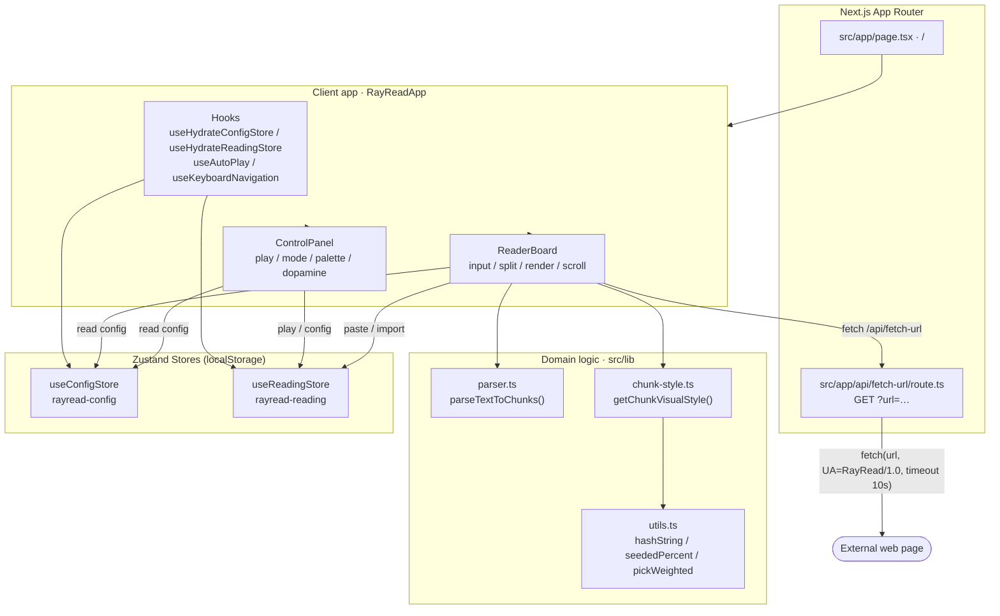
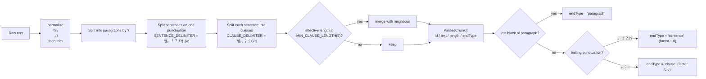
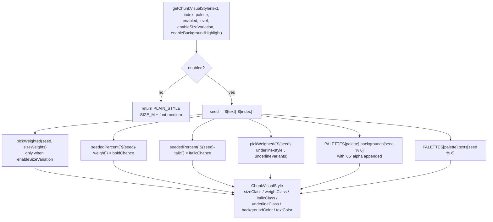
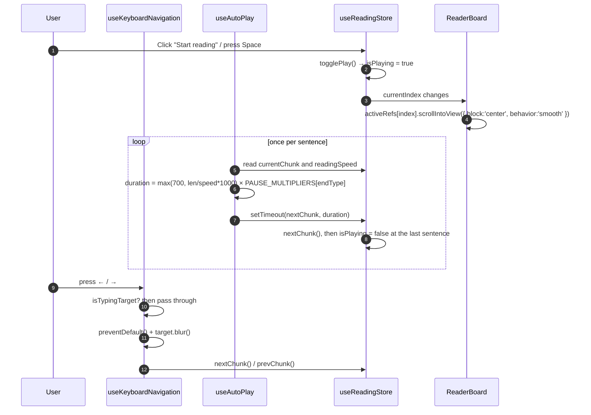
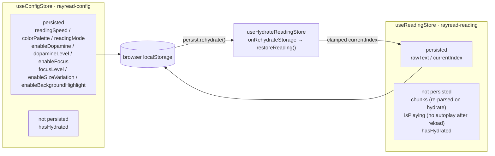
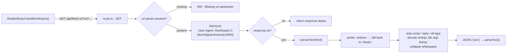

<div align="center">

> **English** | [简体中文](./README.md)


# RayRead — A focus reader that lets your eyes cruise gently from sentence to sentence

**Turn a wall of text into a trail of softly lit little wooden plaques.**


</div>

---

## Why it exists

When you read long text, your eyes always want to run ahead. You juggle a whole screen of words at once, chase one paragraph and then the next, and your attention keeps getting pulled away.

**RayRead splits long text into sentences and short clauses at CJK and Latin punctuation, then lights up only the sentence you are reading while everything else fades into the background.** With auto-cruise and keyboard navigation, you no longer have to "catch up" with a whole article — just follow the sentence in front of you.

It is a **pure front-end reader with no account and no database**:

> The reading body is **never written to disk**; only your preferences and reading progress live in the browser `localStorage`, and nothing is uploaded. The URL-to-text feature goes through a single server proxy route purely to bypass browser CORS limits.

---

## ✨ Features

- 🔤 **Smart sentence splitting**: splits sentences on `。！？.!?` and clauses on `，、；,;`, keeping the original punctuation; fragments that are too short (effective length ≤ 5) are merged into their neighbours.
- 💡 **Sentence highlight + focus mode**: the active sentence gets a warm-yellow highlight `bg-[#fff7d6]` and a slight scale-up, while the rest drop to 30% opacity; the `page` focus level adds a full-screen dimming overlay for a spotlight effect.
- ⏱️ **Auto-cruise**: dwell time is computed from sentence length and reading speed, and can be paused/resumed; commas pause shorter, paragraph ends pause longer.
- ⌨️ **Keyboard navigation**: `Space` / `→` for next, `←` for previous; text boxes, text inputs and contenteditable areas are skipped, and focused controls are actively blurred.
- 🖥️ **Two reading modes**: `Lyrics` shows one sentence per block-level card (trace-and-read), while `Document` keeps continuous prose flow with inline highlighting.
- 🎨 **Dopamine styling**: three intensity levels (`gentle` / `dopamine` / `jumpy`) randomly vary font size, bold, italic, underline (solid/wavy/double), text color and translucent background color.
- 🌈 **Four color palettes**: `Macaron`, `Mid-Century`, `Morandi`, `Ink Wash`, all following a "light background + dark text" rule to reduce long-session eye strain.
- 📥 **Multiple import paths**: paste directly, drag/select a `.txt` file, or paste a web URL and let the server proxy extract the article body.
- 📊 **Reading stats**: live reading time, sentences read, and estimated time remaining.
- 🔄 **Resume where you left off**: reload the page and your text and position are restored (`chunks` are recomputed on hydrate).
- 🔒 **Privacy-friendly**: the reading body is not persisted; only preferences are stored locally.

---

## 🚀 Quick Start

### Option 1: For AI Agents (one-shot install, recommended)

Send this prompt to your local AI Agent (Claude Code / Codex / OpenCode …) and it will install and launch RayRead for you:

````markdown
Please install and run RayRead (GitHub: https://github.com/RayMorTwinkle/RayRead).
Context: RayRead is a pure front-end focus reader built on Next.js 15. It splits long text into sentences, highlights them one by one, and auto-cruises.
Requirements: Node.js 18.18+, npm as the package manager (the repo ships package-lock.json).

Steps:
1. Clone: git clone https://github.com/RayMorTwinkle/RayRead.git && cd RayRead
2. Install dependencies: npm install
3. Start the dev server: npm run dev
4. Open http://localhost:3000 — you should see the RayRead reading UI
5. Optional checks: npm run lint and npm run typecheck should both pass
6. Confirm to the user, then briefly explain "paste text → start reading → keyboard navigation"
````

### Option 2: For humans

```bash
# 1. Clone the repository
git clone https://github.com/RayMorTwinkle/RayRead.git
cd RayRead

# 2. Install dependencies
npm install

# 3. Start the dev server
npm run dev
```

Then open <http://localhost:3000>.

> **Requirements**: Node.js **18.18+** (required by Next.js 15) and npm.
> The repo ships a `package-lock.json` and defaults to **npm**. If you insist on pnpm/yarn, delete `package-lock.json` and `node_modules` before installing to avoid lockfile conflicts.

### Commands

| Command | Description |
|---|---|
| `npm run dev` | Start the Next.js dev server (default `localhost:3000`) |
| `npm run build` | Build the production bundle |
| `npm run start` | Run the production build |
| `npm run lint` | Run ESLint over `src/**/*.{ts,tsx}` |
| `npm run typecheck` | Run `tsc --noEmit` |

---

## 🖥️ Usage

### Typical workflow

```text
① Paste text   → Paste an article / note / novel excerpt into the left textarea
                 (or drag a .txt file, or click "Import URL" to paste a link)

② Auto-split   → RayRead splits it into chunks on the fly; the top-right badge shows "N sentences"

③ Start        → Click "Start reading" or press Space to enter auto-cruise

④ Step through → ← / → move sentence by sentence; the active sentence scrolls to center

⑤ Tune         → Adjust speed, mode, palette, dopamine intensity and focus level on the right

⑥ Close it      → Reopen later and you return to the same text and position
```

### Control panel

| Control | Description | Value / default |
|---|---|---|
| Start reading / Pause cruise | Main action button (native `<button>`, teal `island` theme) | Requires text |
| Previous / Next | Manual sentence stepping | Auto-disabled at boundaries |
| Reading mode | `Lyrics` / `Document` | default `lyrics` |
| Reading speed | Chars-per-second slider | `2–40`, default `10` |
| Color palette | Four light-bg / dark-text palettes | default `macaron` |
| Dopamine styling | Master switch for random decoration | on by default |
| Dopamine level | `gentle` / `dopamine` / `jumpy` | default `dopamine` |
| Immersive focus | Dim all non-active sentences | on by default |
| Focus level | `sentence` / `page` (spotlight overlay) | default `sentence` |
| Advanced: size variation | Slight per-sentence size ripple | off by default |
| Advanced: sentence background | When off, only text color varies | on by default |

### Keyboard shortcuts

| Key | Action |
|---|---|
| `Space` / `→` | Next sentence (also blocks page scrolling) |
| `←` | Previous sentence |

> When focus is inside a `textarea`, a text-type `input`, or a `contenteditable` element, the shortcuts **do not** take over — typing behaves normally.

---

## 🏗️ Architecture

### System overview

All business logic lives on the client: the root route `/` renders `RayReadApp`, which composes the left board and the right panel and drives reading through three core hooks and two Zustand stores. The only server-side logic is the `/api/fetch-url` proxy.



### Text-splitting data flow

`parseTextToChunks()` is a pure function using a three-stage "sentence → clause → merge short clauses" strategy, tagging each chunk with its semantic ending type.



### Deterministic style generation

Dopamine styling **must never** call `Math.random()` during render, or SSR and CSR would disagree and trigger a hydration mismatch. RayRead derives reproducible pseudo-random values with `hashString` (FNV-1a) seeded by `${text}-${index}`.



### Auto-cruise and keyboard stepping

Auto-cruise is driven by `setTimeout` inside `useAutoPlay`; keyboard input is captured globally by `useKeyboardNavigation`. Both call the single `nextChunk` / `prevChunk` data source, so there is no second state machine.



### State and persistence

Both Zustand stores use `persist` + `skipHydration: true` and rehydrate manually from a hook on the client, keeping SSR/CSR consistent. The internal `hasHydrated` flag is explicitly excluded from `partialize` so runtime state is never persisted.



### URL fetch route

`/api/fetch-url` is the project's only server-side logic, used to bypass CORS and turn an external web page into plain text.



---

## 📂 Project layout

```text
RayRead/
├── src/
│   ├── app/
│   │   ├── page.tsx                 # root route /, renders RayReadApp
│   │   ├── layout.tsx               # root layout (imports animal-island-ui/style + global CSS)
│   │   ├── globals.css              # color variables, background gradients, font stack, slider styles
│   │   └── api/fetch-url/route.ts   # the only server route: URL body extraction
│   ├── components/
│   │   ├── RayReadApp/RayReadApp.tsx    # top-level client shell, mounts hooks / Cursor / Footer
│   │   ├── ReaderBoard/ReaderBoard.tsx  # text input, imports, chunk rendering, active-sentence scrolling
│   │   ├── ReaderBoard/ChunkItem.tsx    # sentence render unit (block / inline + Framer Motion)
│   │   └── ControlPanel/ControlPanel.tsx# play, mode, speed, palette, dopamine, focus, advanced
│   ├── hooks/
│   │   ├── useAutoPlay.ts               # auto-cruise timer
│   │   ├── useKeyboardNavigation.ts     # global keyboard stepping (input exemption + blur)
│   │   ├── useHydrateConfigStore.ts     # manual config-store rehydrate
│   │   ├── useHydrateReadingStore.ts    # manual reading-store rehydrate
│   │   └── useReadingStats.ts           # time / sentences read / remaining estimate
│   ├── lib/
│   │   ├── parser.ts                    # parseTextToChunks() three-stage split
│   │   ├── chunk-style.ts               # getChunkVisualStyle() deterministic styling
│   │   └── utils.ts                     # cn / hashString / seededPercent / pickWeighted
│   └── store/
│       ├── reading-store.ts             # rayread-reading: text, chunks, index, playing
│       └── config-store.ts              # rayread-config: all reading preferences
├── docs/animal-island-ui/           # component-library API, design prompt and skill docs
├── archive/                         # early requirements drafts
├── AGENTS.md                        # AI Agent code-navigation guide
├── tailwind.config.ts               # parchment / island / bark custom colors
└── next.config.mjs                  # only reactStrictMode: true
```

---

## 🔧 Technical notes

**Stack versions** (from `package.json`): Next.js `^15.5.15` (App Router) · React `^18.3.1` · TypeScript `^5.9.3` (`strict: true`) · Zustand `^5.0.8` · Tailwind CSS `^3.4.18` · framer-motion `^12.23.24` · animal-island-ui `^0.7.4` · lucide-react `^0.546.0` · clsx + tailwind-merge. Path alias `@/* → ./src/*`.

**Splitting constants** (`src/lib/parser.ts`):

| Constant | Value |
|---|---|
| `SENTENCE_DELIMITER` | `/([。！？.!?]+)/g` |
| `CLAUSE_DELIMITER` | `/([，、；,;]+)/g` |
| `MIN_CLAUSE_LENGTH` | `5` |
| `ParsedChunk.id` | `${hashString(`${chunk}-${index}`).toString(16)}-${index}` |

`getEffectiveLength()` strips whitespace and all punctuation before deciding whether a clause is too short, so fragments like "um,," are never mistaken for a real clause.

**Deterministic randomness** (`src/lib/utils.ts`): `hashString` uses FNV-1a (offset basis `2166136261`, prime `16777619`, final `>>> 0` to unsigned); `seededPercent(seed) = hashString(seed) % 100`; `pickWeighted(seed, options)` accumulates weights. The style seed is fixed to `` `${text}-${index}` ``.

**Dopamine level probabilities** (`LEVEL_CONFIGS` in `src/lib/chunk-style.ts`):

| Level | Bold | Italic | Underline | Background | Text color | Size weights S/M/L |
|---|---|---|---|---|---|---|
| `gentle` | 22% | 0% | 8% | 7% | 18% | 15 / 55 / 30 |
| `dopamine` | 35% | 6% | 18% | 16% | 42% | 18 / 50 / 32 |
| `jumpy` | 50% | 14% | 30% | 28% | 70% | 18 / 42 / 40 |

Font sizes use arbitrary-value classes `text-[1rem] leading-[inherit]` / `text-[1.1rem]` / `text-[1.25rem]` — **deliberately not** `text-lg`/`text-xl`, whose bundled `line-height` would override the `leading-[2.1]` of Document mode. Backgrounds are appended with `66` alpha (≈ 40% opacity).

**Four palettes**: `macaron` (default), `mid-century`, `morandi`, `ink-wash`, each with 6 paired "light background + dark text" entries; background and text are chosen by the same index.

**Auto-cruise** (`src/hooks/useAutoPlay.ts`): base duration `Math.max(700, (chunk.text.length / readingSpeed) * 1000)`, multiplied by the semantic pause factor `PAUSE_MULTIPLIERS = { sentence: 1.0, clause: 0.6, paragraph: 1.4 }`. At the last sentence, `nextChunk()` sets `isPlaying` to `false`.

**Keyboard exemption** (`src/hooks/useKeyboardNavigation.ts`): `isTypingTarget()` treats only `textarea`, text-type `input` (via the `TEXT_INPUT_TYPES` allowlist) and `contentEditable` as "typing"; `radio` / `checkbox` / `button` are not exempt. On a navigation key it calls `preventDefault()` then `blur()`s the target, so focus never gets trapped on a radio/switch.

**Focus levels** (`ChunkItem.tsx` + `RayReadApp.tsx`): in `sentence` mode non-active sentences sit at `opacity: 0.3`; in `page` mode they sit at `opacity: 0.45`, the active one gains a `z-30` glow shadow, and `RayReadApp` overlays a full-screen `bg-[#2f281f]/35` mask.

**Global paths & config**: `next.config.mjs` only sets `reactStrictMode: true`; `tailwind.config.ts` extends `parchment` `#f8f8f0`, `island` `#19c8b9`, `bark` `#725d42` plus `fontFamily.island`; `globals.css` defines `--rayread-bg/card/text/muted` and the `.rayread-range` slider; `layout.tsx` sets `<html lang="zh-CN">` and metadata (title `RayRead`).

**No env vars, no database, no server business module**: the repo contains no `process.env.*` reads and no ORM schema; the only server file is `src/app/api/fetch-url/route.ts`.

---

## ❓ FAQ

**Q: Will my reading content be uploaded?**
A: No. The body lives only in browser memory and `localStorage`, and `reading-store`'s `partialize` persists just `rawText` and `currentIndex`. The only network request is the one you trigger with "Import URL", which fetches through the same-origin `/api/fetch-url` proxy on your own machine.

**Q: Does my progress survive a reload? Are text and progress saved together?**
A: Yes. `rayread-reading` persists `rawText` + `currentIndex`; on hydrate, `chunks` are **recomputed** with `parseTextToChunks()` and `currentIndex` is clamped to bounds. `isPlaying` is not persisted, so playback does not auto-resume.

**Q: Why npm only, not pnpm?**
A: The repo ships `package-lock.json`. If you switch to pnpm/yarn in a fresh environment, delete `package-lock.json` and `node_modules` first; otherwise lockfile and hoisting differences can break dependency resolution.

**Q: URL import keeps failing — what now?**
A: The proxy has a 10-second timeout (`AbortSignal.timeout(10000)`) and only extracts server-rendered HTML; client-side-rendered (CSR) sites may yield nothing. Article-style pages (with an `<article>` tag) work best.

**Q: The sentence styling looks "random" but never flickers. Why?**
A: Styling is deterministic via `hashString(`${text}-${index}`)`, so the same text at the same position always resolves identically on server and client — no hydration mismatch.

**Q: Can I deploy it on Vercel?**
A: Yes — it is a standard Next.js project (`npm run build` + `npm run start`, or one-click Vercel import). No deployment config is bundled in the repo (specific platform TBD).

---

## ⚠️ Notes

- Requires **Node.js 18.18+**; older Node versions cannot build Next.js 15.
- Reading body and progress live in browser storage — **clearing site data loses your progress**, and it does not sync across browsers or devices.
- URL import is a **server-side proxy**: do not use it for pages that require login or that raise legal/compliance concerns.
- Dopamine probabilities and palette parameters are **visual tuning knobs**: after editing `LEVEL_CONFIGS` or `PALETTES`, confirm the levels differ noticeably but not excessively.
- Any change to UI-affecting randomness **must** keep using `hashString` / `seededPercent`; never introduce `Math.random()`.

---

## 📄 License

This repository currently ships **no open-source license file**. If you plan to distribute it or let others use it, consider adding a license (e.g. MIT). Until then, all rights are reserved by default.

---

## 🙏 Credits

- The visual language and many base components (`Button` / `Card` / `Collapse` / `Switch` / `Cursor` / `Footer` / `Typewriter`, etc.) come from **[animal-island-ui](https://www.npmjs.com/package/animal-island-ui)**; its API, design prompt and skill docs are collected under `docs/animal-island-ui/`.
- Built on **Next.js**, **React**, **Zustand**, **Tailwind CSS** and **Framer Motion** — thanks to their communities.
- The icon, README (bilingual) and architecture diagrams in this repository were remade for this project.

---

<div align="center">
<sub>RayRead · Don't chase the whole article — just follow this one sentence</sub>
</div>
